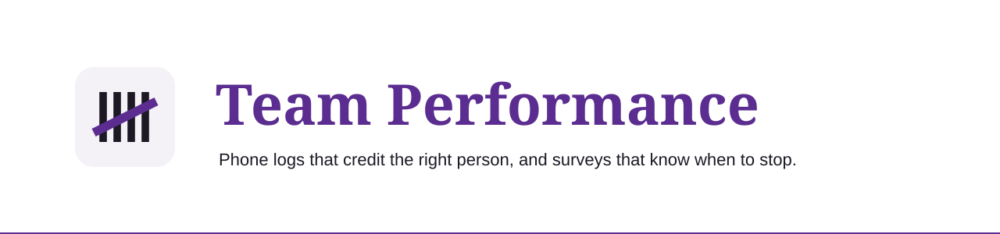
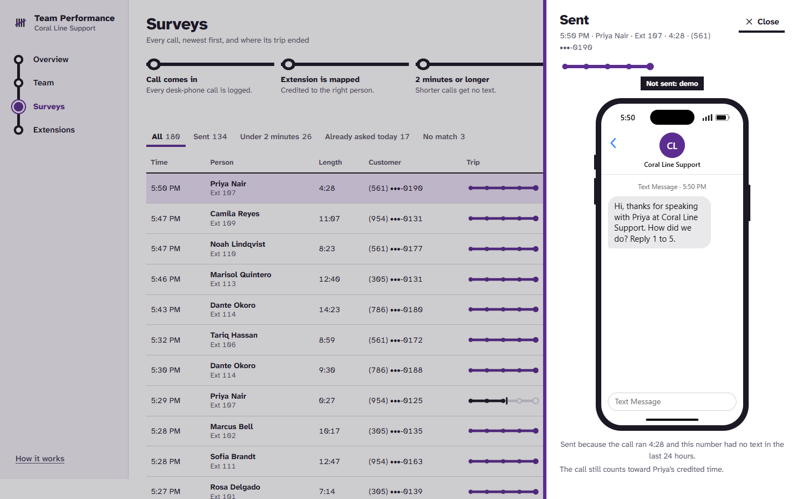
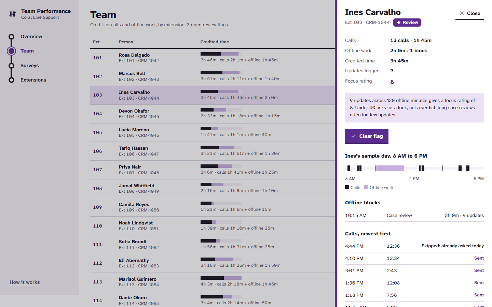

<p align="center"></p>

<p align="center">
  
  
  
  
</p>

**Phone logs that credit the right person, and surveys that know when to stop.**

[Live site](https://team-performance-demo.vercel.app) · press Try the demo

## Status

| Row | |
|---|---|
| Phase | Live |
| Shipped | Landing page and the full demo (Overview, Team, Surveys, Extensions), live 2026-11-17 |
| Next | #11, minor polish from the code review |
| Updated | 2026-11-17 |

## Screenshots

<p align="center">
  
  
</p>

## What it does

The demo plays **Coral Line Support**, a made-up call center of 14 people in South Florida. Everything runs in the visitor's browser.

- Credits every desk-phone call to the right person through an extension-to-person map, with no manual entry.
- Credits offline work too (case review, paperwork) and turns it into a focus rating: logged updates ÷ offline minutes × 100, capped at 100.
- Flags a focus rating under 40 as "Review", a question a supervisor clears, never a verdict.
- Decides every survey text by two plain rules: no text for a call under 2 minutes, and no second text to the same number within 24 hours.
- Shows each call as a trip along a route, ending at the rule that stopped its text, or at "Texts sent".
- Runs a sample batch of 20 new calls on demand, and exports the call log as a CSV that opens cleanly in Excel.
- Lets the visitor map a new extension and watch its next calls get credited.

## What it never does

- Never sends anything. No text, phone system or CRM is reached; every drawn text says "Not sent: demo".
- No backend, sign-in or database ([ADR 0001](docs/adr/0001-browser-only-demo.md)). The demo is saved in the visitor's browser only, and still works when storage is blocked.
- No real business or person. Made-up names only.
- No measured claims (time saved, response rate).

## Stack

Next.js 16 (App Router, all routes static), React 19, TypeScript, Tailwind CSS 4, Vitest. Hosted on Vercel.

## Run it locally

Needs Node 24 (what CI uses). No env file is needed. `SITE_URL` is optional and defaults to the live address.

```bash
npm install
```

```bash
npm run dev
```

## Tests

```bash
npm run test:unit
```

Never `npm test`: it prints an error on purpose. CI runs lint, typecheck, unit tests, the build, and a check that the old client's name never reaches the build output.

## Docs

- Spec: [docs/superpowers/specs/2026-11-17-team-performance-design.md](docs/superpowers/specs/2026-11-17-team-performance-design.md)
- Plan: [docs/superpowers/plans/2026-11-17-team-performance.md](docs/superpowers/plans/2026-11-17-team-performance.md)
- Look: [DESIGN.md](DESIGN.md) · Product: [PRODUCT.md](PRODUCT.md)
- ADR: [0001 browser-only demo](docs/adr/0001-browser-only-demo.md)

---

<p align="center"><sub>Built by <a href="https://tekguyz.com">TEKGUYZ</a></sub></p>
